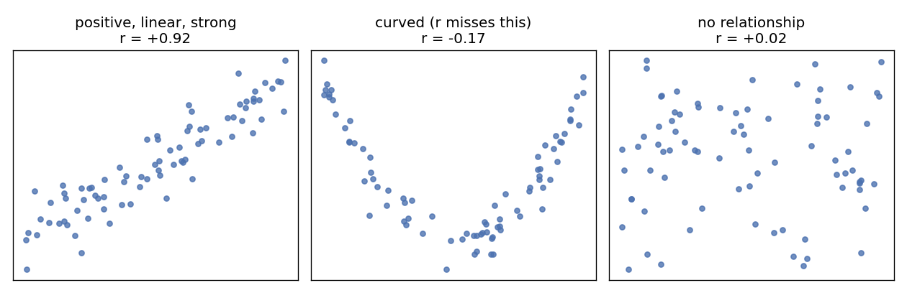
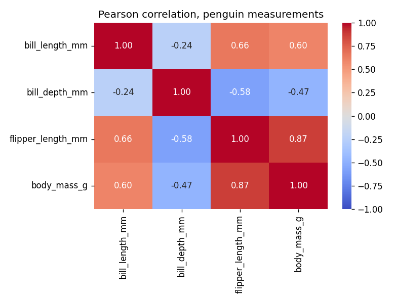

## Learning Objectives

By the end of this lesson you will be able to:

- **Compute and interpret** Pearson's r, and **connect** it to L18 — r is the cosine of the two mean-centered columns, covariance is their dot product, and centering is what lets r go negative — and **read** r as the angle between those columns. *(Apply / Understand)*
- **Recognize** r's three blind spots (linear-only, outlier-sensitive, blind to groups) and **choose** Spearman when it is the honest measure. *(Analyze)*
- **Use** correlation as a predictive tool — fit a best-fit line and read r-squared as the fraction of variance it explains. *(Apply)*
- **Critique** a correlation claim — causation, confounders, and Simpson's paradox. *(Evaluate)*

> **Where this sits:** after **L18** gave you the dot product and cosine · this lesson turns them into correlation · next, **L20** uses the same vector machinery for PCA.

> **Hands-on:** [Lab — Penguin Relationships & a Paradox](l19_lab_correlation.md) ·
> [](https://colab.research.google.com/github///blob//u05_visualization/l19_lab_correlation.ipynb)

## Why This Matters

In L18 you learned that the dot product measures how *aligned* two vectors are, that cosine turns
it into a magnitude-free score from -1 to +1, and that **mean-centering** — shifting the origin to
each vector's own average — is what lets opposite tastes come out negative (Ana and Carla went from
+0.52 to -0.95). **Correlation is that exact idea applied to two columns of data**: center each
column on its mean, then take the cosine. This lesson builds the number from L18's
machinery, then spends the rest of its time on the four ways the number can fool you. Here is the
warning, built by the statistician Francis Anscombe in 1973 — four datasets with the same mean of x
(9.0), same mean of y (7.5), same variances, and the same correlation r = 0.82:


**Reading the output:** only dataset I is what "r = 0.82" makes you imagine. II is a *curve* — a perfect
relationship r understates. III is a perfect *line* hijacked by one outlier. IV has *no* relationship —
one extreme point manufactures the whole statistic. Four identical summaries, four different stories. The
discipline: read the picture and the number together, then refuse the causal leap.

## A One-Number Summary of a Relationship

The picture is the **scatter plot** from L09 — one point per row, read with four words: *direction*
(does y rise or fall as x grows?), *form* (could a straight line describe it?), *strength* (how tightly
do points hug the form?), and *unusual points*. Correlation puts a number on the first three — but only
for the *linear* part of the form:



**Reading the output:** the first panel is what correlation measures well. The middle panel is the trap —
an obvious, strong relationship (a parabola) that r calls "-0.17, basically nothing", because the rule it
checks is *linear*. The right panel is genuine noise. The plot distinguishes the last two; the number
alone cannot.

## Measuring It: from L18's Dot Product to r

How do we put a number on "they move together"? Start with **covariance**: subtract each column's mean
(center it — L18's shift of origin, applied to a column instead of a user's row), then take the
**dot product** of the two centered columns and divide by `n - 1`. When x and
y are both above their means on the same rows, those products are positive, so covariance is positive.
That dot product is precisely L18's operation:

```python
xc = x - x.mean()           # center column x
yc = y - y.mean()           # center column y
covariance = (xc @ yc) / (len(x) - 1)     # L18's dot product, averaged
```

Covariance has the right *sign* but useless *units* (grams times millimeters?), so its size means nothing.
**Pearson's correlation coefficient** fixes that by dividing out both standard deviations — which is
exactly L18's move from dot product to **cosine** (divide by both vectors' lengths):

$$
r = \frac{\sum_i (x_i - \bar{x})(y_i - \bar{y})}{\sqrt{\sum_i (x_i - \bar{x})^2}\,\sqrt{\sum_i (y_i - \bar{y})^2}}
  = \frac{x_c \cdot y_c}{\lVert x_c \rVert \, \lVert y_c \rVert}
$$

::: {.callout-important title="Correlation IS the cosine of the centered columns"}
Read the right-hand side: it is L18's cosine formula, with the two vectors being the **mean-centered
columns**. So Pearson's r is the cosine of the angle between the centered data vectors — `r = +1` means
they point the same way, `r = -1` opposite, `r = 0` perpendicular ("no linear alignment"). In the lab you
will compute r both with `pandas.corr()` and with L18's `xc @ yc / (norm(xc) * norm(yc))` and watch them
agree to six decimals (+0.871202 for flipper length vs body mass).
:::

That forces $-1 \le r \le +1$; the sign gives direction, the magnitude the strength of the **linear**
relationship:

| r (magnitude) | Conventional read |
|----------------|-------------------|
| 0.9 to 1.0 | very strong |
| 0.7 to 0.9 | strong |
| 0.4 to 0.7 | moderate |
| 0.1 to 0.4 | weak |
| 0.0 to 0.1 | none detected |

These bands are *conventions, not laws* — in physics r = 0.7 may be weak; in social science it may be a
career.

### Why Center First? The Positive Corner Again

L18 showed that all-positive vectors live in the **positive corner**, so their cosine can never go
negative: Ana and Carla scored +0.52 although their tastes are opposite. Penguin measurements are all
positive too — no bill is -3 mm deep — so skip the centering and every pair of columns looks
aligned:

| Pair of columns | Cosine of the raw columns | r (cosine after centering) |
|---|---|---|
| flipper length vs body mass | +0.991 | +0.871 |
| bill depth vs body mass | +0.966 | **-0.472** |

All six pairs of the four measurements give a raw cosine between 0.966 and 0.996: the raw arrows
all point roughly along the diagonal, the "every measurement is big" direction, and the cosine
reports that, not the relationship. Centering subtracts each column's mean, so what remains is
*above or below this column's average*. Now bill depth and body mass come out **negative**, a
sign the raw cosine could never show (the Simpson's-paradox section below explains where that
negative comes from).
The rule is L18's, applied to columns: **center first, then compare directions.**

### Reading r as an Angle

Because r is a cosine, every r is also an **angle** between the two centered columns:
`np.degrees(np.arccos(r))`. Two arrows always share one flat plane, whatever the number of rows,
so the angle is as real as the one between Ana and Carla.

| r | Angle between the centered columns | Read |
|---|---|---|
| +1 | 0 degrees | same direction: a perfect rising line |
| +0.87 | 29.4 degrees | flipper length vs body mass |
| +0.5 | 60 degrees | moderate — **not** 45: the angle is not proportional to r |
| 0 | 90 degrees | perpendicular: no linear alignment |
| -0.47 | 118.2 degrees | bill depth vs body mass |
| -1 | 180 degrees | opposite: a perfect falling line |

Under 90 degrees, r is positive; at exactly 90 it is zero; over 90 it is negative. **Try it:** turn
the angle and watch the cloud of points that has exactly that r.

::: {.panel-tabset}

## Turn the angle (interactive)

```{ojs}
//| echo: false
viewof corrAngle = Inputs.range([0, 180], {value: 30, step: 1, label: "angle between the centered columns (degrees)"})
```

```{ojs}
//| echo: false
angleDial = {
  // Two fixed seeded columns (from _tools/figures/cdat4001_l19_correlation.py --js).
  // Center both, remove z's shadow on x, scale to unit length: x and z are now
  // perpendicular unit arrows, and y = cos(angle) x + sin(angle) z has r = cos(angle).
  const baseX = [-0.37, 0.99, 0.42, -0.62, 0.67, -1.45, 0.59, -0.56, 0.63, 0.44, -0.77, 0.53, 0.34, -0.65, 2.00, 0.80, -1.18, -0.99, 0.32, 0.31, -0.73, 1.22, 0.10, -0.86, -0.37, -0.18, -1.55, -0.83, -1.81, -0.29, 0.61, -1.29, 0.32, -1.18, -0.16, -0.52, -1.21, -0.55, -1.23, 0.29, 0.05, 1.20, -1.46, 1.09, -0.08, 0.41, -0.19, 1.55, 1.39, 1.07];
  const baseZ = [0.26, -2.34, 0.56, -0.03, -0.13, 0.43, 1.19, 0.27, -0.47, -0.78, 0.37, 1.10, 0.55, 0.46, -0.45, -1.24, 0.95, 0.61, -1.83, -0.72, 1.00, 1.07, -0.64, 2.25, 1.40, 0.96, -0.13, -1.39, 0.81, 1.78, 0.91, -1.08, 1.14, -0.66, -2.20, 0.32, -2.71, 0.11, 1.01, 1.04, 2.72, 0.67, -0.98, 0.62, 0.68, -0.58, -1.75, -0.37, -0.69, -0.40];
  const n = baseX.length;
  const mean = (v) => v.reduce((s, a) => s + a, 0) / v.length;
  const dot = (u, v) => u.reduce((s, a, i) => s + a * v[i], 0);
  const mx = mean(baseX), mz = mean(baseZ);
  let x = baseX.map((a) => a - mx);
  let z = baseZ.map((a) => a - mz);
  const k = dot(z, x) / dot(x, x);
  z = z.map((a, i) => a - k * x[i]);
  const nx = Math.sqrt(dot(x, x)), nz = Math.sqrt(dot(z, z));
  const sc = Math.sqrt(n - 1);
  x = x.map((a) => a / nx * sc);
  z = z.map((a) => a / nz * sc);
  const t = corrAngle * Math.PI / 180;
  const c = Math.cos(t), s = Math.sin(t);
  const y = x.map((a, i) => c * a + s * z[i]);
  const my = mean(y);
  const yc = y.map((a) => a - my);
  const rCloud = dot(x, yc) / (Math.sqrt(dot(x, x)) * Math.sqrt(dot(yc, yc)));
  const isZero = corrAngle === 90;
  const col = isZero ? "gray" : (c > 0 ? "seagreen" : "darkorchid");
  const fmt = (v) => (isZero ? "0.000" : (v >= 0 ? "+" : "") + v.toFixed(3));

  // left: the two centered columns as unit arrows in their shared plane
  const W1 = 220, H1 = 150, s1 = 80, cx1 = 110, cy1 = 110;
  const X1 = (v) => cx1 + s1 * v, Y1 = (v) => cy1 - s1 * v;
  const ra = 0.3;
  const arc = `M ${X1(ra)} ${Y1(0)} A ${s1 * ra} ${s1 * ra} 0 0 0 ${X1(ra * c)} ${Y1(ra * s)}`;
  const arrows = htl.svg`<svg width="${W1}" height="${H1}" viewBox="0 0 ${W1} ${H1}" style="max-width: 100%; height: auto; font-family: sans-serif;">
    <defs>
      <marker id="l19-head-x" viewBox="0 0 10 10" refX="9" refY="5" markerWidth="7" markerHeight="7" orient="auto-start-reverse"><path d="M 0 0 L 10 5 L 0 10 z" fill="crimson"></path></marker>
      <marker id="l19-head-y" viewBox="0 0 10 10" refX="9" refY="5" markerWidth="7" markerHeight="7" orient="auto-start-reverse"><path d="M 0 0 L 10 5 L 0 10 z" fill="steelblue"></path></marker>
    </defs>
    <line x1="0" y1="${cy1}" x2="${W1}" y2="${cy1}" stroke="#ccc" stroke-width="1"></line>
    <line x1="${cx1}" y1="0" x2="${cx1}" y2="${H1}" stroke="#ccc" stroke-width="1"></line>
    <path d="${arc}" fill="none" stroke="black" stroke-width="1.2"></path>
    <line x1="${X1(0)}" y1="${Y1(0)}" x2="${X1(1)}" y2="${Y1(0)}" stroke="crimson" stroke-width="3" marker-end="url(#l19-head-x)"></line>
    <line x1="${X1(0)}" y1="${Y1(0)}" x2="${X1(c)}" y2="${Y1(s)}" stroke="steelblue" stroke-width="3" marker-end="url(#l19-head-y)"></line>
    <text x="${X1(1)}" y="${Y1(0) + 18}" text-anchor="end" fill="crimson" font-size="12">x centered</text>
    <text x="${Math.max(36, Math.min(X1(c * 1.05), W1 - 36))}" y="${Y1(s * 1.05) - (Math.abs(s) < 0.2 ? 14 : 6)}" text-anchor="middle" fill="steelblue" font-size="12">y centered</text>
  </svg>`;

  // right: the cloud whose r is exactly cos(angle)
  const W2 = 240, s2 = 36, c2 = 120;
  const X2 = (v) => c2 + s2 * v, Y2 = (v) => c2 - s2 * v;
  const dots = x.map((a, i) => htl.svg`<circle cx="${X2(a)}" cy="${Y2(y[i])}" r="3.2" fill="#555" fill-opacity="0.8"></circle>`);
  const cloud = htl.svg`<svg width="${W2}" height="${W2}" viewBox="0 0 ${W2} ${W2}" style="max-width: 100%; height: auto; font-family: sans-serif;">
    <rect x="0.5" y="0.5" width="${W2 - 1}" height="${W2 - 1}" fill="none" stroke="#bbb"></rect>
    <line x1="0" y1="${c2}" x2="${W2}" y2="${c2}" stroke="#ddd" stroke-width="1"></line>
    <line x1="${c2}" y1="0" x2="${c2}" y2="${W2}" stroke="#ddd" stroke-width="1"></line>
    ${dots}
    <text x="${W2 - 6}" y="${c2 - 6}" text-anchor="end" font-size="11" fill="#666">x</text>
    <text x="${c2 + 6}" y="14" font-size="11" fill="#666">y</text>
  </svg>`;

  const kind = isZero ? "zero: no linear alignment" : (c > 0 ? "positive: y tends to rise with x" : "negative: y tends to fall as x rises");
  const lab = "padding-right: 1.5em;";
  const table = htl.html`<table style="font-family: monospace; font-size: 0.95rem;">
    <tr><td style="${lab}">angle</td><td style="text-align: right;">${corrAngle} deg</td></tr>
    <tr><td style="${lab}">cos(angle)</td><td style="text-align: right;">${fmt(c)}</td></tr>
    <tr><td style="${lab}"><b>r of this cloud</b></td><td style="text-align: right;"><b>${fmt(rCloud)}</b></td></tr>
    <tr><td colspan="2" style="color: ${col};">${kind}</td></tr>
  </table>`;
  return htl.html`<div style="display: flex; flex-wrap: wrap; gap: 1.2rem; align-items: center;">${arrows}${cloud}${table}</div>`;
}
```

## Static view


:::

**Reading the dial:** the two panels show the same data two ways. On the left are L18's
arrows: each centered column is one arrow, with one coordinate per data point. On the right is
the usual scatter: one dot per data point. The angle lives *between the arrows*, not between the
cloud and the x-axis — on standardized axes a rising cloud always leans along the diagonal, and
what the angle changes is how *thin* the cloud is. A small angle squeezes the cloud into a tight
rising band. Toward 90 degrees
it loosens into a round blob with no tilt, and past 90 it tilts downward, tightening again as the
angle nears 180. r does not move evenly with the angle: the first 30 degrees cost r only 0.13
(from 1 to 0.87), while the 30 degrees from 60 to 90 cost it 0.5. So a cloud with r = 0.5 is already
60 degrees away from a perfect line, two-thirds of the way to no alignment at all — it looks loose
because, measured as an angle, it is.

## r's Three Blind Spots

The bands assume you already looked at the scatter, because r is blind in three ways:

- **Linear only.** Anscombe II (and the parabola above): a real, strong, curved relationship can score
  near zero. *r = 0 does not mean "unrelated".*
- **Outlier-sensitive.** Anscombe III and IV: one point can inflate, deflate, or fabricate r — it is
  built from means and variances, which L08 showed are not robust.
- **Blind to groups.** A mixture of subgroups can produce an r that describes *none* of them — the trap
  of this lesson's final section.

### Spearman: correlation on the ranks

**Spearman's rank correlation** replaces each value with its rank, then computes Pearson on the ranks. It
answers a looser, often more honest question: *does y consistently move in one direction as x grows* —
linearly or not? A series that doubles every step makes the difference concrete:

```python
x = pd.Series(range(1, 11))
y = pd.Series(2.0 ** x)   # doubles every step: monotone but curved
x.corr(y)                     # Pearson  : 0.80
x.corr(y, method="spearman")  # Spearman : 1.00
```

The relationship is *perfectly* monotone, and Spearman says so (1.00), while Pearson docks it to 0.80 for
not being a straight line. **Prefer Spearman when** the scatter is monotone but curved, the data is
ordinal (rankings, survey scales), or outliers are present (ranks tame them). **Stay with Pearson when**
the scatter looks linear — it then uses more of the information.

## Many Pairs at Once: the Correlation Matrix

With four numeric columns there are six pairs — nobody reads six scatters one by one. `df.corr()` computes
r for every pair; a **heatmap** colors the grid so the strong cells jump out:



**Reading the output:** flipper length and body mass at **0.87** is the standout. The strange cells are
bill depth's whole row — negative against everything, including **-0.47** with body mass. (Deeper bills on
*lighter* penguins? That cell is hiding something; the lab catches it.) Note the **color choice** — this
is L16's principle in action: correlation has a meaningful midpoint at 0, so a heatmap of r wants a
**diverging** colormap (`coolwarm`: blue for negative, red for positive, white at zero), never a
sequential or rainbow ramp. The color encodes sign *and* strength at a glance.

## Correlation as a Predictive Tool

If two variables correlate, the correlation also tells you how well a straight line **predicts** one from
the other. Fit the best line through the cloud — `np.polyfit(x, y, 1)` returns its slope and intercept —
and you have a prediction rule:

```python
slope, intercept = np.polyfit(flipper, body_mass, 1)   # 49.7, -5780.8
predicted = slope * 210 + intercept                     # ~4,653 g for a 210 mm flipper
```

How good is that line? **r-squared** (literally r times r) is the fraction of the variance in y that the
line accounts for: here `r = 0.87`, so `r^2 = 0.76` — the line explains about three-quarters of the
variation in body mass, leaving a quarter to everything else. A higher |r| means a tighter cloud, which
means a line that predicts better. (This is the doorway to *regression*, a later topic; here we stop at
the one-line fit and its r-squared.) One caution: a fitted line is trustworthy only *inside* the observed
range — predict a penguin's mass from a 300 mm flipper and you have hope, not evidence.

## Correlation Is Not Causation

The most quoted sentence in statistics, and Unit V's exit exam for judgment. When x and y correlate, there
are always (at least) three candidate explanations:

1. **x causes y** — longer flippers really do add mass.
2. **y causes x** — the reverse.
3. **Something else causes both** — a **confounder** (or *lurking variable*). Ice-cream sales correlate
   with drownings; the confounder is summer.

A correlation alone cannot pick between the three — that takes experiments or domain knowledge. The most
spectacular way a confounder shows itself is:

::: {.callout-important title="Simpson's paradox"}
A correlation that holds in every subgroup can **disappear — or reverse — when the groups are pooled**.
The penguins deliver a textbook case: bill depth vs body mass has overall r = **-0.47**, yet *within every
single species* it is **positive** (+0.58 Adelie, +0.60 Chinstrap, +0.72 Gentoo). The lurking variable is
species — being a Gentoo independently makes a penguin heavier AND shallower-billed, so pooling the three
clouds tilts the line the wrong way. The lab walks you through producing and unmasking it.
:::

![Scatter plot of bill depth (mm) against body mass (g) for 342 penguins, colored by species. The Gentoo points (green) sit upper-left: shallow bills of about 13 to 17 mm and masses of 4,000 to 6,300 g. The Adelie (blue) and Chinstrap (orange) points overlap lower-right: bills of about 16 to 21.5 mm and masses of 2,700 to 4,800 g. Each species has its own solid fitted line, and all three rise: Adelie r = +0.58 and +217 g per mm, Chinstrap r = +0.60 and +205 g per mm, Gentoo r = +0.72 and +369 g per mm. A dashed black line fitted to all three species pooled falls from upper-left to lower-right: r = -0.47 and -192 g per mm.](assets/l19_simpson.png)

**Reading the figure:** inside each species the line rises — a deeper bill goes with a heavier bird,
by about 200 to 370 g per extra millimetre. But the Gentoo cloud sits up and to the left (shallow
bills, heavy birds) and the other two sit down and to the right, so a single line through all three
clouds has to run downhill: -192 g per mm. In angle terms, the centered columns are 118 degrees apart
for the pooled data but only 44 to 55 degrees apart inside each species. Same measurements, opposite
story — the pooled line is describing the gap *between* species, not anatomy *within* one.

The practical rule: **never report a pooled correlation without checking the obvious groupings first**
(`groupby` + per-group r, or a hue-colored scatter).

## Where This Number Keeps Coming Back

This one number turns up across the course:

- **Filter feature selection (L13).** L13's filters scored each feature against the label and kept the
  top-ranked ones, and L13's filter table left the numeric-label case waiting for this lesson. `|r|`
  fills it — here is its row, in the same format:

  | Filter | Columns it fits | Watch out |
  |---|---|---|
  | **Correlation \|r\|** -- needs a numeric label | Numeric features (measurements, counts, 0/1 flags) | Scores only the **linear** part: a curved link can score near 0. One outlier can make or break it, so look at the top features' scatters. Two features with a high \|r\| *with each other* are redundant: keep one. |

- **L17's autocorrelation.** Periodicity in a time series is just r computed between the series and a
  *lagged copy of itself*: a strong r at lag 12 means "this month resembles the same month last year".
  L17 showed the 12-month cycle visually and promised the number here; the lab's Exercise 4 computes it
  for the San Juan temperatures.
- **L22's collaborative filtering.** L18 centered each *user's row* and called the centered cosine a
  correlation. L22's recommenders compare users exactly that way: r between two users' rating rows,
  with the same geometry as r between two columns here.

Correlation is one of the most reused numbers in data science precisely because it is so simple: a cosine
of two centered vectors.

## Common Pitfalls

- **Skipping the centering.** A cosine of raw, all-positive columns is near 1 for almost any pair (about
  0.97 to 0.996 for the penguins) — it measures "both are positive numbers", not a relationship. Correlation is the
  cosine *after* centering.
- **Reading the angle as proportional to r.** r = 0.5 is 60 degrees, not 45; r = 0.87 is still 29
  degrees. A moderate r is further from a perfect line than its size suggests.
- **The causal leap.** "r = 0.87, so flippers cause mass" — nothing in the number supports the verb. Say
  "associated", then argue causation separately.
- **Correlating aggregates.** Correlations on group *averages* (per-island means, per-year totals) are
  routinely stronger than the same correlation on individuals, and can even differ in sign. Say which level
  your r describes.
- **Cherry-picking the matrix.** Compute many pairs and *some* cell will show |r| > 0.5 by luck. Treat
  heatmap findings as leads, not conclusions.
- **Quoting r without asking "could this be chance?"** In a small sample a sizable r can arise from luck;
  the formal check is a significance test (a p-value for r), which exists and is taught later.
- **Extrapolating the line.** A fit holds *inside* the observed range; beyond it you have hope, not
  evidence.

## FAQ / Industry Reality

**"Is r = 0.9 always better evidence than r = 0.5?"** — Better evidence *of linear association in your
sample*, yes. But an r = 0.9 from ten cherry-picked points, a pooled mixture, or one outlier (Anscombe
IV!) is worth less than an honest 0.5 from clean, plotted, group-checked data. The number's pedigree
matters more than its size.

**"My heatmap shows 0.97 between two features — jackpot?"** — More often a red flag: near-perfect
correlation usually means the two columns encode the *same thing* (mass in grams and in kilograms). In
modeling that redundancy causes trouble; the professional reflex to a 0.97 cell is "which one do I drop?"
(exactly L13's redundancy concern), not "what a discovery".

## Cheat-sheet

| Question | Plot | Number |
|----------|------|--------|
| Do two numeric variables move together? | scatter plot (L09) | Pearson's r = `x.corr(y)` |
| How far from a perfect line, as an angle? | the angle dial above | `np.degrees(np.arccos(r))`: under 90 positive, 90 none, over 90 negative |
| ...monotone but curved? ordinal? outliers? | scatter plot | **Spearman** `method="spearman"` |
| Which pairs matter, among many? | heatmap (diverging cmap) | `df.corr()` matrix |
| How well does x predict y? | scatter + best-fit line | `np.polyfit(x, y, 1)`; r-squared |
| Is the pooled correlation honest? | scatter with `hue=` group + per-group lines | per-group r vs overall r |
| Does a series repeat itself? | the series over time (L17) | `s.autocorr(lag=k)` = r with a copy shifted k steps |

## Where to Go Deeper

- **Book chapter:** [R for Data Science — Exploratory Data Analysis](https://r4ds.hadley.nz/eda) — covariation, the same discipline in another language.
- **Official docs:** [pandas — `DataFrame.corr`](https://pandas.pydata.org/docs/reference/api/pandas.DataFrame.corr.html) · [NumPy — `polyfit`](https://numpy.org/doc/stable/reference/generated/numpy.polyfit.html).
- **Classics:** Anscombe, F. J. (1973). "Graphs in Statistical Analysis", *The American Statistician* 27(1) · [Spurious Correlations (tylervigen.com)](https://www.tylervigen.com/spurious-correlations) — a gallery of confounders and coincidences.
