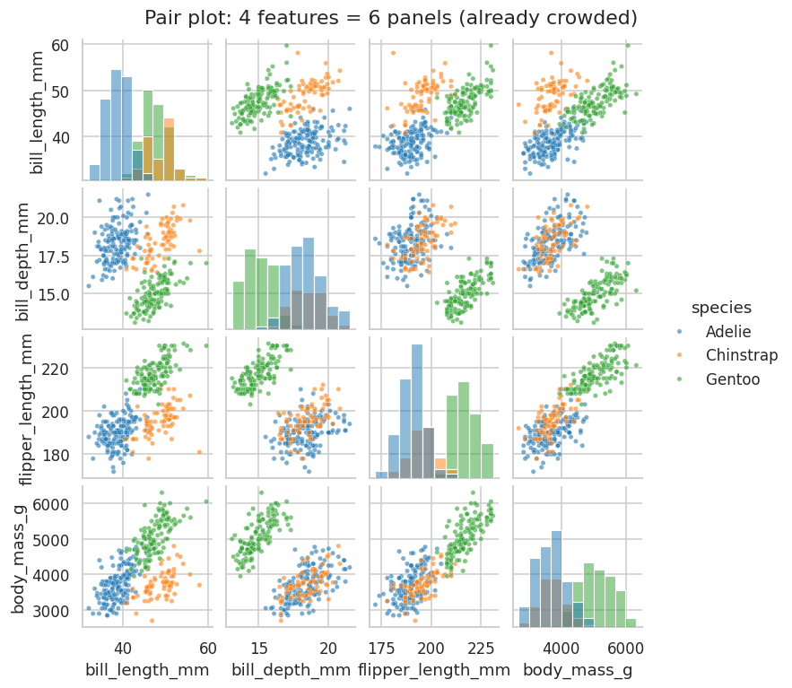
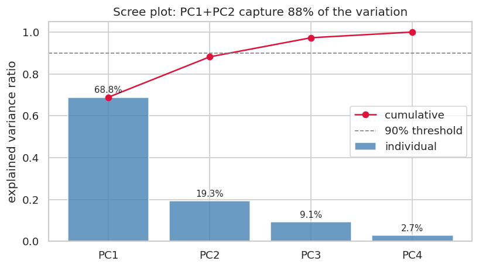

## Learning Objectives

By the end of this lesson you will be able to:

- **Explain** why visualizing many variables is hard — the pairwise-plot explosion — and **use** a pair plot and a parallel coordinates plot to show several variables at once. *(Understand / Apply)*
- **Apply** standardization before PCA and **justify** why unscaled features wreck the result. *(Apply / Analyze)*
- **See** PCA's directions on data you can picture, **compute** a PCA, **interpret** its explained-variance ratio with a scree plot, and **project** the data to 2D — recognizing the projection as L18's shadow, taken after centering. *(Apply / Understand)*
- **Identify** groups and outliers in the projection and **interpret** the loadings — what each new axis means. *(Analyze)*

> **Where this sits:** after **L19** quantified pairs of variables · this lesson handles *many variables* at once, using **L18's** shadows on unit directions and the centering from **L18** and **L19** · next, **L21** finds the groups algorithmically and closes Unit V.

> **Hands-on:** [Lab — Four Measurements, Three Species: PCA on Penguins](l20_lab_penguins_pca.md) ·
> [](https://colab.research.google.com/github///blob//u05_visualization/l20_lab_penguins_pca.ipynb)

## Why This Matters

L19 measured a relationship two variables at a time, and a correlation heatmap scales that to every
pair. But a heatmap tells you which variables move together — not how the *rows* (penguins, municipios,
customers) group. To see the rows you plot them, and the natural tool is the **pair plot**: every
variable against every other. It has a hard ceiling, though, because the number of panels grows as the
*square* of the variable count — 4 variables need 6 panels, 10 need 45, **30 need 435**. You cannot plot
thirty dimensions, and your eyes cannot see past three — yet real tables are exactly that wide.

The standard escape is not to plot every variable but to **reduce** them: build a handful of new,
composite variables that keep most of the variation, then plot those. The headline method is **principal
component analysis (PCA)** — and it is built on the operation you already learned in L18, **projection**.
To see it work, we use 342 penguins measured four ways and watch PCA recover the three species *without
ever being told what a species is*:


**Reading the output:** four measurements per penguin, collapsed to one picture — and the biology falls
out. Two axes hold 88% of everything the four measurements captured, the three species form distinct
clouds, and the one extreme penguin is impossible to miss. That is what dimensionality reduction buys:
structure you could only glimpse across six pair-plot panels, readable at a glance.

## Seeing Many Variables Directly

Before reducing, it is worth seeing how far direct plotting goes. The **pair plot** draws every variable
against every other, with each variable's distribution on the diagonal. At four features it still works —
the species already cluster — but you read it one panel at a time, and the grid is near its useful limit:



A different tactic puts every variable on its own vertical axis and draws one line per row across all of
them — a **parallel coordinates** plot (standardize the axes first, since the units differ):


**Reading the output:** each penguin is now a single line, and Gentoo's shape signature — long flippers,
heavy body, *shallow* bill — is visible in one figure rather than six panels. The weaknesses are real,
though: the picture depends on the order of the axes, and a few hundred lines already begin to tangle. At
thirty variables it becomes spaghetti. Direct plotting delays the ceiling; it does not remove it.

## The Idea of Dimensionality Reduction

The key move is counterintuitive: don't *drop* variables, **combine** them. If flipper length and body
mass nearly always rise together (L19 measured exactly this — they correlate at +0.87), they are partly
telling the same story — "size" — and a single new axis can carry most of what both held. Dimensionality
reduction looks for a few such composite axes that preserve as much of the data's *variation* as possible.

Four penguin measurements live in four dimensions, which nobody can picture. So before the penguins, we
try PCA on data you *can* picture, where you can check its answer by eye.

## PCA You Can See: Stores Along an Avenue

Picture a downtown laid out along one main avenue. We place 82 stores (synthetic and seeded; the lab
builds exactly the same ones):

- **40 stores on the avenue**, which runs 600 meters at 30 degrees north of east, on either sidewalk;
- **14 stores on each of three side streets** that cross the avenue, out to 140 meters either side;
- **each store on some floor**, from the ground (0) up to 15, at 4 meters per floor.

Every store is a point with three coordinates, all in meters: east, north and height. Before reading on,
guess: which direction holds the most spread, which the next, and which the least?

::: {.panel-tabset}

## Rotate it (interactive)

```{ojs}
//| echo: false
Plotly = require("https://cdn.jsdelivr.net/npm/plotly.js-dist-min@2.35.2/plotly.min.js")
viewof storeView = Inputs.radio(["tilted", "from above (the map)", "from the side"], {value: "tilted", label: "Start from"})
```

```{ojs}
//| echo: false
storesPlot = {
  // 82 stores (meters), PCA mean, components and evr: printed by
  // _tools/figures/cdat4001_l20_pca.py --js (the lab's Step 3 recipe, seed 42)
  const east = [397.2, 233.0, 451.1, 357.4, 43.9, 501.9, 400.5, 413.5, 61.6, 229.0, 197.7, 476.6, 329.6, 432.5, 225.4, 123.1, 293.2, 28.2, 425.0, 333.2, 388.9, 189.2, 499.4, 469.1, 399.5, 96.1, 237.5, 17.8, 85.2, 349.9, 392.0, 497.7, 164.3, 197.5, 239.0, 93.5, 72.5, 252.2, 122.9, 353.0, 199.9, 189.9, 179.9, 169.9, 159.9, 149.9, 139.9, 119.9, 109.9, 99.9, 89.9, 79.9, 69.9, 59.9, 329.8, 319.8, 309.8, 299.8, 289.8, 279.8, 269.8, 249.8, 239.8, 229.8, 219.8, 209.8, 199.8, 189.8, 459.7, 449.7, 439.7, 429.7, 419.7, 409.7, 399.7, 379.7, 369.7, 359.7, 349.7, 339.7, 329.7, 319.7];
  const north = [240.8, 123.0, 248.9, 217.9, 36.9, 301.3, 219.7, 227.2, 47.1, 143.8, 102.6, 286.7, 201.8, 238.2, 141.7, 59.5, 157.7, 27.8, 256.9, 180.8, 236.1, 97.7, 299.9, 259.3, 242.2, 67.1, 148.7, 21.8, 37.6, 213.6, 214.8, 298.9, 106.4, 102.5, 149.5, 65.5, 30.3, 134.1, 59.4, 192.3, -46.2, -28.9, -11.6, 5.7, 23.0, 40.4, 57.7, 92.3, 109.6, 127.0, 144.3, 161.6, 178.9, 196.2, 28.8, 46.1, 63.4, 80.7, 98.0, 115.4, 132.7, 167.3, 184.6, 202.0, 219.3, 236.6, 253.9, 271.2, 103.8, 121.1, 138.4, 155.7, 173.0, 190.4, 207.7, 242.3, 259.6, 277.0, 294.3, 311.6, 328.9, 346.2];
  const height = [28, 40, 40, 28, 52, 36, 4, 48, 36, 40, 36, 32, 4, 32, 48, 16, 36, 0, 20, 24, 60, 12, 16, 24, 60, 52, 0, 12, 52, 0, 52, 16, 56, 16, 24, 40, 8, 32, 32, 48, 60, 40, 24, 24, 24, 52, 20, 8, 20, 0, 4, 4, 48, 44, 44, 28, 44, 8, 56, 32, 60, 8, 28, 44, 28, 28, 8, 24, 12, 16, 40, 40, 36, 20, 60, 4, 20, 4, 20, 60, 20, 56];
  const center = [268.08, 155.34, 29.66];
  const pcs = [[0.8653, 0.5012, 0.0044], [-0.5007, 0.8649, -0.0352], [-0.0214, 0.0282, 0.9994]];
  const evr = [0.832, 0.156, 0.012];
  const names = ["PC1 (the avenue)", "PC2 (side streets)", "PC3 (up)"];
  const colors = ["crimson", "darkorange", "purple"];
  const len = 150;  // every arrow 150 m long: they are unit directions
  const traces = [{
    type: "scatter3d", mode: "markers", x: east, y: north, z: height,
    marker: {size: 3.5, color: height, colorscale: "Viridis", cmin: 0, cmax: 60,
             colorbar: {title: {text: "height (m)"}, len: 0.6}},
    hovertemplate: "east %{x} m<br>north %{y} m<br>height %{z} m<extra></extra>"
  }];
  pcs.forEach((d, i) => {
    const tip = center.map((c, k) => c + len * d[k]);
    traces.push({
      type: "scatter3d", mode: "lines+text", x: [center[0], tip[0]], y: [center[1], tip[1]],
      z: [center[2], tip[2]], text: ["", names[i] + " " + (100 * evr[i]).toFixed(1) + "%"],
      textposition: "top center", textfont: {color: colors[i], size: 13},
      line: {color: colors[i], width: 8}, hoverinfo: "text",
      hovertext: names[i] + ": [" + d.map((x) => x.toFixed(3)).join(", ") + "]"
    });
  });
  const cameras = {
    "tilted": {eye: {x: -0.4, y: -1.5, z: 1.1}, up: {x: 0, y: 0, z: 1}},
    "from above (the map)": {eye: {x: 0, y: 0, z: 1.9}, up: {x: 0, y: 1, z: 0}},
    "from the side": {eye: {x: 0.9, y: -1.55, z: 0.05}, up: {x: 0, y: 0, z: 1}}
  };
  const layout = {
    height: 520, margin: {l: 0, r: 0, t: 10, b: 0}, showlegend: false,
    scene: {aspectmode: "data", camera: cameras[storeView],
            xaxis: {title: {text: "east (m)"}}, yaxis: {title: {text: "north (m)"}},
            zaxis: {title: {text: "height (m)"}}}
  };
  const div = htl.html`<div style="width: 100%; max-width: 720px;"></div>`;
  yield div;
  await Plotly.newPlot(div, traces, layout, {displaylogo: false, responsive: true});
}
```

Drag to rotate; scroll to zoom. The axes are at honest 1:1:1 scale, so the floors are a thin layer:
zoom in to see them, and try "from the side".

## Static view

![Three panels of the same 82 stores. Left, a 3-D plot at true scale: the stores form a thin, nearly flat slab along a diagonal avenue with three crossing side streets, and three arrows leave the centroid, red PC1 along the avenue, orange PC2 along the side streets, purple PC3 straight up. Top right, the map seen from above: the avenue runs up to the right with three perpendicular side streets crossing it, and the red and orange arrows lie along them. Bottom right, the floors zoomed in: height in meters from 0 to 60 against the position along the avenue, with a purple arrow labeled PC3 pointing up.](assets/l20_stores_3d.png)

:::

**Reading the 3-D view:** PCA's three answers are the arrows, its **principal components**, numbered
PC1, PC2 and PC3 from the most spread to the least.

- **PC1 runs along the avenue.** Its loadings are 0.865 east, 0.501 north and 0.004 height, a heading of
  30.1 degrees. PCA recovered the avenue's 30 without being told it.
- **PC2 runs along the side streets**, at a heading of 120 degrees.
- **PC3 points straight up** (0.999 on height): the floors.

The arrows start at the **centroid**, the average store, not at the origin (0, 0, 0). They are drawn the
same length because each one is a **unit direction**, length 1, and they meet at right angles: they are
L18's orthogonal vectors, with dot product 0. How much spread each direction holds is a separate number,
the **explained variance ratio**: **83.2%, 15.6% and 1.2%**. Notice that PC1 is neither the east column
nor the north column. It is a *blend*, 0.865 east plus 0.501 north, and it means one physical thing, the
avenue. Every principal component is a blend like this, and reading its loadings is how you name it.

**What dropping a component means.** Drop PC3 and you keep 98.8% of the spread; what you lose is the
floors, and what is left is the street map (top right of the static view). Keep only PC1 and you keep
83.2%: each store becomes a single number, its position along the avenue. That is almost a street address,
and a store on a side street gets the address of its corner. This is dimensionality reduction in one
picture: keep the directions in which the data spreads, drop the ones in which it barely moves.

### Why "Most Variance" Finds the Avenue

PC1 is defined as the direction of greatest variance. On the map you can watch that definition at work.
Put a unit direction through the centroid, cast every store's **shadow** on it (L18's `point @ d`, on
centered coordinates), and measure how spread out the shadows are. Then spin the direction:


**Reading the output:** the spread of the shadows peaks at **30 degrees**, which is PC1's heading, the
avenue: about 22,100 square meters, against about 4,100 at 120 degrees, the side streets. PCA does this
search for you, in any number of dimensions at once. PC1 is the direction with the most spread; PC2 has the
most spread among the directions perpendicular to PC1; PC3 the most among those perpendicular to both.
(PCA finds them with linear algebra instead of trying every angle, but the answer is the same.)

**Same units, so no standardizing.** All three coordinates are meters, so a meter east and a meter up are
directly comparable, and PCA's answer is simply the geometry of the town. Keep that in mind for the next
section: the penguins are measured in grams and millimeters, and there the rule is the opposite.

## Standardize First

PCA finds the directions of greatest *variance* — which makes it dangerously sensitive to units. The
stores were safe because every coordinate was in meters. The penguin features span wildly different
ranges: body mass varies by about 800 (grams), bill depth by about 2 (millimeters). Run PCA on the raw
numbers and the grams column drowns everything:


**Reading the output:** unscaled (left), PC1's loading on body mass is **1.00** and every other feature
is under 0.02 — PCA has merely renamed the grams column. The heaviest species (Gentoo) peels off on that
single axis, but the two lighter species, similar in mass, stay smeared together. After `StandardScaler`
rescales each feature to mean 0 and standard deviation 1 (L11's z-score, packaged as a reusable
transformer), every feature gets an equal vote and all three species separate cleanly (right).

::: {.callout-important title="Standardizing is not optional for PCA"}
Whenever your features are in different units — grams and millimeters, dollars and years, counts and
percentages — standardize before PCA, or the largest-numbered column hijacks the result. The library will
not warn you; the unscaled answer looks perfectly valid and is perfectly meaningless. The one time to
skip it: features that already share a unit and a meaning, like the stores' meters, columns already
z-scored, or the pixels of one image. There, standardizing would *distort* the answer (see Common
Pitfalls).
:::

## Principal Component Analysis

With standardized features, PCA builds the same principal components you saw on the stores: PC1 in the
direction of greatest variation, PC2 in the next-greatest direction *perpendicular* to PC1, and so on. The
only difference is that with four features you can no longer look at the arrows; you read them from the
numbers. Each component's explained variance ratio, its share of the total spread, is what a **scree
plot** lays out:



**Reading the output:** PC1 alone holds 68.8% of all the variation among penguins, PC2 another 19.3% —
**two new axes carry 88% of what four measured ones held**, so a 2D scatter of PC1 against PC2 loses almost
nothing. The bars fall off a cliff after PC2 (the "elbow"): that drop is the visual cue for how many
components are worth keeping. A stricter rule — keep enough to reach 90% of the variance — would take three
here. "How many components" is a judgment call between those two readings.

::: {.callout-note title="PCA is L18's projection: center, then cast shadows"}
PCA does two things you already know from L18. First it **centers**: it subtracts each column's mean,
moving the origin to the middle of the cloud (that is why the stores' arrows start at the centroid, and it
is the same fix as L18's positive corner and L19's centered columns). Then it **projects**: each score is
the **shadow** of a centered point on one component, `point @ d` with `d` a unit direction. For a whole
table at once that is

$$\text{scores} = (X - \text{mean}) \, W,$$

where the columns of `W` (`pca.components_.T`) are perpendicular unit directions. Standardized data
already has mean 0, so for the penguins this shrinks to L18's `X @ W`, and the lab checks that
`pca.transform(X)` equals `X @ pca.components_.T` to machine precision. On the raw stores the same check
fails until you subtract the mean. PCA's one genuinely new idea is *which* directions it projects onto: the
`W` that captures the most variance, instead of an axis handed to you, like L18's action-versus-romance
line.
:::

## Reading the Projection

Two questions finish the analysis: what do the axes *mean*, and what does the scatter *show*. The
**loadings** answer the first — they say how each original feature contributes to each component. For the
penguins, PC1 loads positively on flipper length, body mass, and bill length but negatively on bill depth:
an **overall size** axis (the big, shallow-billed Gentoo build). PC2 is almost all bill measurements: a
**bill shape** axis. Like the stores' avenue, each one is a blend, named from its loadings. Drawn as arrows on the scatter, the loadings make a **biplot** (the arrows in this
lesson's opening figure). Loadings are at most about 0.8 while the scores spread over several units, so
the arrows are stretched three times to be visible; read their directions and relative lengths, not
their size.

One reading needs care. PC1 loads *negatively* on bill depth, so along PC1 the bigger penguins have the
shallower bills. That describes the **species**, not penguins in general: Gentoo are big and
shallow-billed, Adelie and Chinstrap are smaller and deep-billed, and PC1 lines the species up. Inside each
species it goes the other way, which is L19's **Simpson's paradox**: bill depth and body mass correlate at
-0.47 pooled but positively within every species. Run PCA on one species at a time and PC1 loads
positively on all four measurements, bill depth included (+0.49 to +0.52): a plain "bigger everywhere"
axis. A loading describes the data you handed PCA. Pool several groups, and it describes the differences
*between* them.

The scatter itself answers the second question — and it is where **groups and outliers** become visible.
The three species, whose labels PCA never saw, form three clouds: Gentoo far along PC1 (mean PC1 +2.01,
the big ones), Adelie and Chinstrap overlapping on size but split on PC2 by bill shape. PCA rediscovered
the biology from four numbers per bird. The lone penguin in the far corner is an **outlier** — extreme on
both axes at once (the lab tracks down exactly which bird and why) — the kind of point an analyst should
always inspect before trusting a model.

## When to Use Which

- **Pair plot** — a handful of variables (say $\le 6$) where you want every raw relationship. Honest and
  direct, but explodes with width.
- **Parallel coordinates** — a dozen-ish variables, to compare whole profiles across groups. Standardize
  first; mind the axis order.
- **PCA** — many variables, especially correlated ones, when you want one 2D overview and are willing to
  read composite axes instead of raw ones.
- **Correlation heatmap (L19)** — when the question is *which variables move together*, not *how the rows
  cluster*. Often the right first look before deciding whether PCA will even help.

## Common Pitfalls

- **Forgetting to standardize.** The largest-unit column becomes PC1 and the rest vanish. The single most
  common PCA mistake.
- **Standardizing what already shares a unit.** The opposite mistake. Standardize the stores and PC1 snaps
  to a heading of about 45 degrees instead of the avenue's 30: east and north are each divided by their own
  spread, and once they have equal spread, PC1 falls on the diagonal no matter where the avenue runs. The
  floors also get the same vote as 600 meters of avenue. When every column is the same quantity in the same unit, the raw geometry *is* the
  answer.
- **Reading meaning into low-variance components.** PC4 here holds 2.7% of the variance — mostly noise.
  Interpret the components that the scree plot says matter, not all of them.
- **Treating PC axes as physical quantities.** "PC1" is a blend, not millimeters of anything. Name it from
  its loadings; never report it as a raw measurement.
- **PCA on the wrong data.** It needs numeric, roughly linearly related features. One-hot categorical
  columns, or strongly curved relationships, break its assumptions — and if a pair plot already answers the
  question, PCA only adds a layer of abstraction.

## FAQ / Industry Reality

**"Is the first component the most important variable?"** — No, and this trips up beginners constantly.
PC1 is not a variable at all; it is a weighted blend of *all* of them, chosen to capture the most spread.
"Most variance" also is not "most important" for any particular question — a low-variance direction can
carry the signal you actually care about. PCA ranks directions by spread, not by relevance to your goal.

**"Does PCA find the clusters for me?"** — No. PCA is *unsupervised* but it does not assign group labels;
it reveals structure that you still have to interpret (here, we colored by a species label we already had).
To have an algorithm *assign* groups, you need a clustering method — k-means is the usual first one — which
is the subject of **L21**, the very next lesson, and is often run *on* the PCA output. This lesson finds
groups by eye; L21 names them automatically.

**"How many components should I keep?"** — There is no single rule. Three common ones: the **elbow** in
the scree plot (where the bars flatten), a **cumulative-variance threshold** (keep enough to reach 90%,
say), or — if PCA feeds a model — whatever number gives the best validated performance. For *visualization*
the answer is usually just two or three, because that is what you can plot.

## Cheat-sheet

| Task | Call |
|---|---|
| Every pair of variables | `sns.pairplot(df, hue="label")` |
| Many axes, one figure | `parallel_coordinates(df, "label")` (standardize first) |
| Standardize features | `StandardScaler().fit_transform(X)` |
| Fit PCA | `PCA().fit(X_scaled)` |
| Variance per component | `pca.explained_variance_ratio_` |
| Project to 2D (L18's shadows) | `pca.transform(X_scaled)` |
| The same scores by hand | `(X - pca.mean_) @ pca.components_.T` |
| What the axes mean | `pca.components_` (the loadings) |
| Unit length, perpendicular? | `pca.components_ @ pca.components_.T` (the identity) |
| Cumulative variance | `np.cumsum(pca.explained_variance_ratio_)` |

## Where to Go Deeper

- **Official docs:** [scikit-learn — Decomposition (PCA)](https://scikit-learn.org/stable/modules/decomposition.html#pca) — the API, `whiten`, and the variants (incremental, kernel, sparse PCA).
- **Textbook:** J. VanderPlas, *Python Data Science Handbook* — "In Depth: Principal Component Analysis" — PCA as visualization, noise filtering, and the geometry behind the projection, with worked code.
- **The dataset:** [Palmer Penguins](https://allisonhorst.github.io/palmerpenguins/) — Horst, Hill & Gorman's CC0 replacement for Iris, with the measurement diagrams behind the four features.
