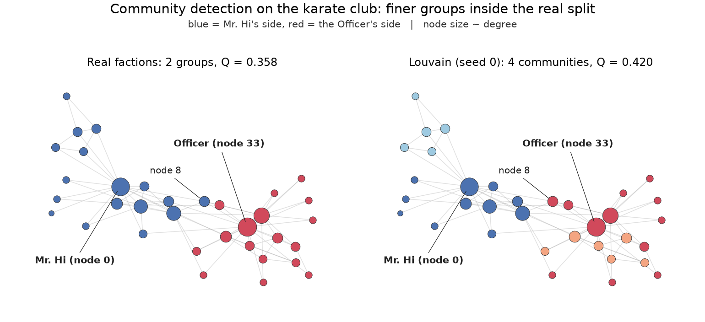

## Learning Objectives

By the end of this lesson you will be able to:

- **Define** a **community** in a network, **explain** **modularity** as a score for how community-like a grouping is, and **compute** it from each group's inside-edge count and degree sum. *(Understand / Apply)*
- **Apply** community detection (the **Louvain** method and greedy modularity) in NetworkX and **read** the number of communities found and the modularity achieved. *(Apply)*
- **Compare** a detected grouping to a **ground-truth** labelling with **normalized mutual information (NMI)**, and **explain** why detection can find more groups than the truth. *(Analyze)*
- **Distinguish** community detection from **graph partitioning** (balanced, minimum edge-cut) and say when each is the right tool. *(Analyze / Evaluate)*

> **Where this sits:** **L25** built the graph and measured *one node at a time* (degree, centrality, neighbourhood) · this lesson asks the **global** question — do the nodes fall into **communities**? · it is **L21**'s "find the groups" idea, now on a *graph* instead of a point cloud · it **closes Unit VII**.

> **Hands-on:** [Lab — Community Detection on the Karate Club](l26_lab_community_detection.md) ·
> 

## Why This Matters

L25 ended on a cliff-hanger. In the early 1970s the karate club Wayne Zachary was studying **split in
two**: after the instructor (Mr. Hi) and the president (the Officer) fell out, every member followed one
or the other. Zachary's question was whether the *friendship structure alone* — who was friends with
whom, recorded before the split — could have predicted who went where. L25's lab came close to an
answer: sorting the adjacency matrix by the real factions showed two dense blocks, with only 11 of the
78 friendships crossing between them. But that sort used the answer.

We now have the tools to do it without the answer. An algorithm that knows nothing about the conflict,
only the graph, can look for **communities**: groups of members densely connected to each other and
sparsely connected to everyone else. This is the "find the groups" instinct from **L21** — but where L21
grouped *points* by distance, here we group *nodes* by connection. Community detection is everywhere
relationships are: friend circles in a social graph, topic clusters in a citation network, functional
modules in a protein-interaction network, market segments in a co-purchase graph. And the punchline for
the karate club is striking — from the graph alone, the real split comes back almost exactly.

## What Is a Community?

A **community** is a set of nodes with **many edges inside the group and few edges leaving it**. That is
the whole intuition: dense within, sparse between. The trouble is that "dense within, sparse between" is a
matter of degree, not a yes/no — so we need a *score* that says how good a proposed grouping is.

## Measuring a Grouping: Modularity

**Modularity**, written $Q$, scores a partition of the nodes by comparing the edges that fall *inside*
the groups with how many would fall inside **by chance**, given each node's degree. For each group $c$,
let $L_c$ be the number of edges inside it and $d_c$ the sum of its members' degrees; $m$ is the
number of edges in the whole graph. Then

$$Q = \sum_{c} \left[ \frac{L_c}{m} - \left( \frac{d_c}{2m} \right)^2 \right].$$

The first term is the share of all edges that fall inside group $c$. The second is the share you would
expect inside it by chance: every edge has two ends, $2m$ ends in all, and the group's members hold
$d_c$ of them, so a randomly placed edge has both ends in the group with probability about
$(d_c / 2m)^2$.

As in L25, we work with the **friendship graph** — an edge means "friends", and the interaction counts
NetworkX also stores are left out (`weight=None`). Check the formula on the real split, with the numbers
from L25's sorted matrix: Mr. Hi's faction has 35 friendships inside and a degree sum of 81, the
Officer's has 32 and 75, and the club has 78 friendships in all:

$$Q = \frac{35 + 32}{78} - \left(\frac{81}{156}\right)^2 - \left(\frac{75}{156}\right)^2 = 0.859 - 0.501 = 0.358.$$

Inside the factions sit 86% of the friendships; chance would put about half there. Reading the score:

- $Q$ near **0** means the grouping is no better than chance — no real community structure. Splitting
  the members by even versus odd id scores $Q = -0.0001$, essentially zero ($Q$ can even dip
  slightly below zero).
- Higher $Q$ means edges concentrate inside the groups far more than chance would predict — strong
  communities. Networks with clear communities typically score between about **0.3 and 0.7**.

So the karate club's **real two-faction split**, at $Q = 0.358$, is solidly community-like: the
friendships really did cluster around the two leaders. And modularity turns "are these good
communities?" into a number an algorithm can push up.

## Finding Communities

We do not need the ground truth to find communities — that is the point. We hand the graph to an
algorithm that searches for a grouping with **high modularity**:

- **The Louvain method** — the standard, fast approach: it moves nodes between groups and merges groups
  as long as $Q$ goes up, and it **chooses the number of communities itself** (you do not tell it how
  many). It is a **heuristic**: it starts from a random order and stops when no single move helps, so
  different seeds can return different groupings. `nx.community.louvain_communities(G, seed=0, weight=None)`.
- **Greedy modularity** — a related agglomerative method: start with every node alone and keep merging
  the pair of groups that raises $Q$ the most. Fully deterministic:
  `nx.community.greedy_modularity_communities(G, weight=None)`.

Run Louvain on the karate club (seed 0) and something instructive happens: it finds **four**
communities, with **$Q = 0.420$** — *higher* than the real two-way split's 0.358. Greedy modularity
finds three ($Q = 0.381$).

{fig-alt="Two node-link drawings of the karate club with the same layout and node size proportional to degree. Left, the real factions: Mr. Hi's side in blue, the Officer's side in red, modularity Q = 0.358. Right, the four communities Louvain finds with seed 0, modularity Q = 0.420: two shades of blue on Mr. Hi's side and two shades of red on the Officer's side. Node 8, a member of Mr. Hi's faction, is blue on the left and red on the right."}

Read the figure side to side. Each faction (left) is split into two tighter groups on the right — a dark
and a light shade of the same colour. Every one of the four communities comes from a single faction,
except **node 8**: a Mr. Hi member whom Louvain puts with the Officer's friends.

Why four and not two? Because **maximizing modularity rewards finer structure**: splitting a faction into
two tightly-knit sub-groups can raise $Q$ further. The algorithm is not "wrong" — it found a
higher-scoring grouping than the social split. It optimizes modularity, and on this graph the
best-scoring groupings are more granular than the two real camps. Two more things to keep in mind:

- **The seed matters, the big picture does not.** Across seeds, Louvain returns three or four
  communities with $Q$ between 0.385 and 0.420; every run finds more than two groups, beats the real
  split's $Q$, and keeps Mr. Hi and the Officer apart. Trust conclusions that survive several seeds.
- **Granularity is adjustable.** Louvain's `resolution` parameter (default 1) trades size for number:
  below 1 it favours fewer, larger communities. At `resolution=0.5` it returns two.

## Did It Get It Right? Ground Truth and NMI

When you *do* have a ground-truth labelling (here, the real faction each member joined), you can measure
how well a detected grouping agrees with it. The standard score is **normalized mutual information
(NMI)**. It builds on the **mutual information** from L13, which there scored how much a feature tells you
about a label; here it measures how much one labelling of the members tells you about another, normalized
to run from **0** (no agreement) to **1** (identical grouping).

- Louvain's four communities vs the two real factions: **NMI = 0.588** — a moderate match. It recovered
  the factions but then subdivided them, which costs agreement.
- Ask instead for **exactly two** communities (`greedy_modularity_communities(G, cutoff=2, best_n=2)`):
  **NMI = 0.677**, and only **2 of the 34** members fall on the wrong side of the real split (nodes 8
  and 9).

That second result is Zachary's answer: **the friendship structure alone nearly predicts the fission** —
two mistakes out of thirty-four, with no knowledge of the conflict. Sort the adjacency matrix by the two
*detected* groups and L25's picture comes back without the labels: two dense blocks, 34 friendships inside
each, and only **10** crossing — one fewer than the 11 that cross the real split. By structure alone, the
detected grouping is slightly tidier than what actually happened. The two "mistakes" are telling: node 8
had more friends on the Officer's side but, by Zachary's account, stayed with the instructor because a
black-belt test was weeks away; node 9 had just two friends, one on each side.

## A Different Goal: Graph Partitioning

Community detection asks "where are the natural dense groups?" — and lets the groups be any size. A
related but distinct task, **graph partitioning**, asks something else: split the nodes into a *fixed
number of balanced parts* while cutting **as few edges as possible** (the **edge-cut**). The
**Kernighan-Lin** heuristic does this for two parts:
`nx.community.kernighan_lin_bisection(G, seed=42, weight=None)`.

On the karate club (seed 42) it produces two parts of **17 and 17** with an edge-cut of **10** — exactly
the split that forced detection found, not the real one (whose cut is 11). Like Louvain, it starts from
a random split, and a few seeds stop at a worse cut. On this graph the two methods meet. In
general they do not, because the *purpose* is different, and so is the constraint:

| | Community detection | Graph partitioning |
|---|---|---|
| **Goal** | maximize internal density (modularity) | minimize edges cut between parts |
| **Group sizes** | vary freely (5, 6, 11, 12 ...) | forced balanced (17, 17) |
| **Number of groups** | chosen by the algorithm | fixed by you (k) |
| **Typical use** | find natural social / topical groups | shard a graph across machines; load-balance |

Use **partitioning** when you must spread a huge graph evenly across servers with the fewest cross-machine
links. Use **community detection** when you want the *natural* groups, whatever their sizes.

> **Unit VII complete.** L25 turned relationships into a graph and measured local structure; L26 found the
> global structure — the communities — and recovered a real social split from the graph alone.
> Overlapping communities, dynamic (time-evolving) communities, and other detection methods (label
> propagation, edge-betweenness) are where this goes next; named here, not pursued.

## FAQ

**There are two real factions — why does Louvain find four communities?**
Because Louvain maximizes **modularity**, and subdividing each faction into two tighter sub-groups scores
*higher* than the two-way split. It is optimizing modularity, not trying to match the social split. Lower
the `resolution` (0.5) or ask for exactly two groups, and it recovers the factions almost exactly.

**Louvain gave me a different answer than my classmate's. Who is right?**
Possibly both. Louvain starts from a random order, so different seeds (or library versions) can settle on
different groupings with slightly different $Q$. Compare their $Q$, and trust what every run agrees
on — here, more than two groups and the two leaders apart.

**Is a higher modularity always a better answer?**
Higher $Q$ means denser-inside groups, but not necessarily the grouping *you* want. The four-community
solution has higher $Q$ than the real two-faction split, yet the two-faction grouping is the one that
matches reality. Modularity is a useful objective, not the final word — match it to your goal.

**Community detection or graph partitioning — how do I choose?**
If you need the **natural** groups and do not care about their sizes, detect communities. If you must
split the graph into a **fixed number of balanced parts with the fewest crossing edges** (for example, to
shard a database across servers), partition it.

**Does NMI need the groups to have the same names?**
No. It compares two labelings over the same nodes — here the detected community id and the true faction
for each member — and only asks how well one predicts the other. Renaming the groups does not change
NMI.

## Cheat-sheet

Every call takes `weight=None`, so NetworkX scores the friendship graph and ignores the interaction counts
it also stores.

| You want... | Do this |
|-------------|---------|
| Score a grouping | `nx.community.modularity(G, list_of_sets, weight=None)` |
| Score it by hand | $\sum_c[L_c/m-(d_c/2m)^2]$ |
| Find communities, auto count | `nx.community.louvain_communities(G, seed=0, weight=None)` |
| Check Louvain's stability | rerun with several seeds; compare $Q$ and the groups |
| Fewer, larger communities | `louvain_communities(G, seed=0, weight=None, resolution=0.5)` |
| Find communities, deterministic | `nx.community.greedy_modularity_communities(G, weight=None)` |
| Force exactly k communities | `greedy_modularity_communities(G, weight=None, cutoff=k, best_n=k)` |
| Balanced halves, fewest cut edges | `nx.community.kernighan_lin_bisection(G, seed=42, weight=None)` |
| Compare to ground truth | `normalized_mutual_info_score(true_labels, found_labels)` |

## Where to Go Deeper

- **NetworkX community documentation** — the `networkx.algorithms.community` reference.
- **Santo Fortunato, "Community detection in graphs" (2010)** — the comprehensive survey (start with the
  modularity sections).
- **Barabasi, *Network Science* (free online), Chapter 9** — communities, modularity, and the Louvain
  method, with the resolution limit explained.
- **Wayne Zachary, "An Information Flow Model for Conflict and Fission in Small Groups" (1977)** — the
  original karate-club study, including the member who stayed for the black-belt test.
